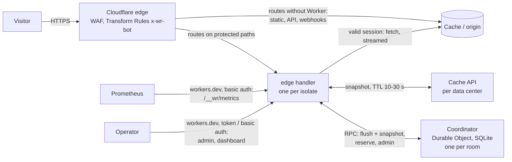

# cf-waitingroom

A self-hosted waiting room for Cloudflare Workers and Durable Objects. It admits visitors at a
controlled **rate** (new users per minute) and gives every queued visitor an exact admission time,
instead of approximating a stock of active users per data center.

It was built to replace the managed Cloudflare Waiting Room on an e-commerce site with ~2k active
users at peak, after three behaviours were observed in production (see [docs/comparison.md](docs/comparison.md)):
false queueing at low traffic, overshoot during steep ramps, and queues clogged by abandoned
places and cookie-less bots. Each of them has a simulation that proves it is not reproduced.

- **Rate-based admission.** Two settings: admission rate `R` (users/minute) and session duration `D`.
  Active users settle at `R × mean session length` (Little's law).
- **Exact slots, no polling.** A queued visitor's page reserves a slot (`admitAt`) once, shows a
  precise countdown and reloads at `admitAt`. Bots that keep no cookie never get a slot; reservations require a proof of work (optional Turnstile).
- **No false queueing.** While capacity is free, isolates admit from leased blocks of slots with
  no coordinator call per visitor; the token bucket is rebuilt from the real admission times.
- **Bounded overshoot.** Admissions beyond `R` are bounded by the outstanding leases and the bucket
  depth, and tested. Overbooking compensates no-shows (`R_eff = R / (1 − absence)`, capped).
- **Cheap on the hot path.** A valid session costs one HMAC check: no Durable Object call, the
  origin response is streamed untouched (one `Set-Cookie` per user per minute at most).
- **Zero runtime dependency**, TypeScript, one Worker of ≈ 90 KiB minified (edge handler and Durable Object).

## Quick start

First installation: follow [INSTALL.md](INSTALL.md), which explains each step, what to choose and
what the route script creates. The summary below is for readers who already know wrangler.

Requirements: Node.js ≥ 22, a Cloudflare zone, Workers Paid (Durable Objects with SQLite storage).

```sh
npm ci
npm test                     # unit tests, simulations, integration tests (Workers runtime)

cp wrangler/waitingroom.example.jsonc wrangler/waitingroom.jsonc
# edit it (name, ROOM_ID, ADMIN_HOSTS, bootstrap configuration), then:
npx wrangler deploy --config wrangler/waitingroom.jsonc          # first: secrets need an existing Worker
npx wrangler secret put WR_KEYS --config wrangler/waitingroom.jsonc          # {"1":"<base64 of 32+ random bytes>"}
npx wrangler secret put WR_KEY_CURRENT --config wrangler/waitingroom.jsonc   # 1
npx wrangler secret put WR_ADMIN_TOKEN --config wrangler/waitingroom.jsonc
npx wrangler secret put WR_METRICS_USER --config wrangler/waitingroom.jsonc
npx wrangler secret put WR_METRICS_PASSWORD --config wrangler/waitingroom.jsonc
npx wrangler secret put WR_DASHBOARD_USER --config wrangler/waitingroom.jsonc       # optional: /__wr/dashboard
npx wrangler secret put WR_DASHBOARD_PASSWORD --config wrangler/waitingroom.jsonc
# routes: deploy/scripts/routes.sh apply deploy/test.env (copy of deploy/routes.env.example), test hostname first
# operator endpoints: on the Worker's workers.dev hostname only (docs/operator-access.md)
```

Generate a key with `openssl rand -base64 32`. Keep the real configuration in a private repository;
this repository only holds examples. Follow [docs/runbook.md](docs/runbook.md) for the cut-over.

## Architecture



One Worker (`src/index.ts`) exports both parts:

- **edge** (`src/edge`): fetch handler, waiting page, whitelist, admin API, metrics, dashboard.
- **coordinator** (`src/coordinator`): the Durable Object class. Every deployment of the Worker
  (secret changes included) restarts the object and clears its memory; state is reloaded from SQLite.
  Deploy outside traffic events; live changes go through the admin API.
- **core** (`src/core`): the whole algorithm as pure functions with an injected clock, driven both by
  the Workers and by the simulations (`test/sim`).

The coordinator never runs alarms: it recomputes on every RPC. Each isolate accumulates deltas
(admissions, redeemed tickets, per-minute session counts) and flushes them in one RPC that returns the
state snapshot; isolates with nothing to send read the snapshot from the Cache API.

## How a request is handled

| Request | Decision | Coordinator call |
|---|---|---|
| Static extension/prefix (early exit) | relay untouched | none |
| Valid session cookie | relay, cookie rewritten at most once a minute | none |
| Whitelisted (IP/CIDR, secret header, verified bot, signed link) | relay, counted separately | none |
| First visit, open mode | relay + provisional cookie (no slot used) | none |
| Second request, open mode | leased slot, session cookie | ~1 per lease |
| Queue (cursor ahead of the clock), `queue_all` or pause | waiting page; its JS reserves a slot | 1 per queued human |
| Ticket due (`now ≥ admitAt`) | session cookie, relay | none (batched) |

Details: [docs/routing.md](docs/routing.md), [docs/algorithm.md](docs/algorithm.md).

## Cost model

Durable Object usage is driven by the number of active isolates and by the queued humans, not by raw
traffic. Simulated monthly requests (R = 200/min, 100 bot req/min, 30-day month):

| Active isolates | 10 % of R | 25 % of R | 50 % of R | 80 % of R |
|---|---|---|---|---|
| 5 | 0.2 M | 0.2 M | 1.2 M | 1.8 M |
| 10 | 0.3 M | 0.4 M | 2.1 M | 3.4 M |
| 20 | 0.6 M | 0.8 M | 3.4 M | 8.1 M |
| 50 | 1.4 M | 2.5 M | 6.3 M | 11 M |

Queue mode adds one request per queued human (the reservation). Workers Paid includes 1 M Durable
Object requests per month, then $0.15 per million: even the worst cell above costs about $1.50 per
month. The single always-active object uses ≈ 324,000 GB-s per month (400,000 included). The
coordinator exports a projection from its last hour (`wr_cost_projection_usd`, `wr_usage_projection`)
and the number of active isolates (`wr_coordinator_isolates`). See [docs/cost-model.md](docs/cost-model.md).

## Known limits

- One coordinator object per room (≈ 1,000 req/s soft limit): fine for one site, not for a global
  multi-tenant service. Queue mode costs one request per queued human.
- Overshoot after a flash crowd that hits a calm room is bounded by `calmLeaseMaxOutstandingSec +
  burstSec` of `R` (≈ 35 s of admissions with the defaults), once.
- A ticket copied before use is admitted at most once per isolate until the next flush; the copies are
  revoked within one snapshot TTL and only the first redemption keeps its session.
- Configuration and kill-switch changes reach every data center within two snapshot TTLs (≤ 60 s
  when calm, ≤ 20 s otherwise), as long as isolates reach the coordinator; during an outage an
  isolate keeps its last snapshot for `STALE_SNAPSHOT_TTLS` TTLs, then the fail mode applies.
- Whitelisted traffic without cookies (IP, verified bots, secret header) is deduplicated per isolate
  only: the whitelist counter is an estimate.
- No scheduled events, no random queue, no integrated Turnstile (a verification hook exists).

## Documentation

- [Installation](INSTALL.md): step by step, from an empty account to a test hostname.
- [Configuration](docs/configuration.md): the three configuration layers and every setting.
- [Routing](docs/routing.md): what is intercepted, what is not, and what each case costs.
- [Algorithm](docs/algorithm.md): slots, leases, overbooking, brake, replay protection, restart.
- [Runbook](docs/runbook.md): cut-over, rollback, kill switch, deployment freeze, key rotation.
- [Monitoring](docs/monitoring.md): Prometheus scrape, Grafana dashboard (`deploy/grafana`), suggested alerts.
- [Operator access](docs/operator-access.md): admin, metrics and dashboards on `workers.dev` only.
- [Threat model](docs/threat-model.md).
- [Public interfaces](docs/interfaces.md): cookie format v1, admin API v1, metrics.
- [Cost model](docs/cost-model.md) · [Comparison with the managed waiting room](docs/comparison.md) · [WAF interaction](docs/waf.md)

## License

Apache-2.0, see [LICENSE](LICENSE). Not affiliated with Cloudflare, Inc.
